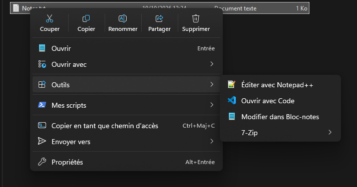
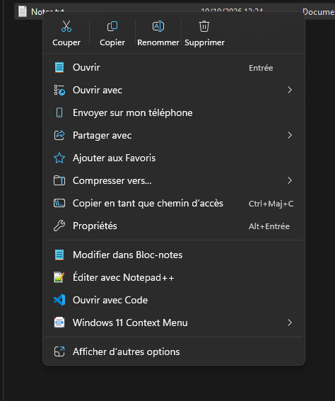
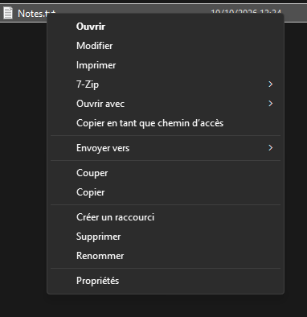
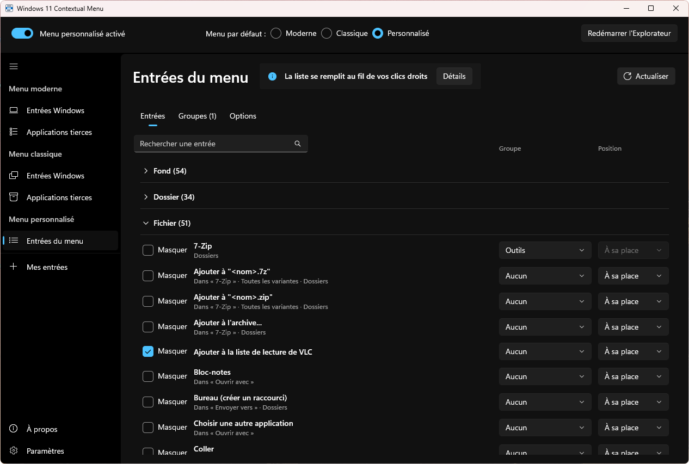

  

<h1 align="center">Windows 11 Contextual Menu</h1>

<strong>Take back control of the Windows 11 right-click menu.</strong>

  
  
  
  
  

  <a href="https://github.com/Xavinooo/Windows11ContextualMenu.Releases/releases/latest"><strong>⬇ Download</strong></a>

  

## Why?

The Windows 11 right-click menu looks better, but it is less handy:

- **Two menus instead of one.** 7-Zip, Notepad++, “Send to”… are hidden behind “Show more options”.
- **Nothing to adjust.** You cannot remove an entry, add one or change their order without editing the registry.
- **The old menu looks out of place.** Bringing it back takes a little-known registry key, and it has neither icons nor a dark theme.
- **It gets cluttered** as you install more software.

Windows 11 Contextual Menu fixes all this without modifying Windows: one switch brings back the original menu.

## What it does

| | |
| --- | --- |
| 🎛️ **Choose your menu** | Modern, classic (without “Show more options”) or custom. |
| 🙈 **Hide** | The entries of Windows and of your apps that you never use. |
| ➕ **Add** | Your own commands or sub-menus (a 7-Zip template is provided). |
| 🎨 **Custom menu** | The whole classic menu, redrawn like Windows 11: icons, light or dark theme, adjustable transparent background, action bar. Each entry can be hidden, grouped or moved. |
| ⌨️ **Shortcuts** | Ctrl + right-click for Windows' classic menu, Ctrl + Shift to run as administrator. |
| ↩️ **Go back** | One switch restores the original menu, without losing your settings. |
| 💾 **Back up** | Export your settings to a file and import them back, on this PC or another one. |
| 🌍 **Six languages** | English, French, German, Spanish, Italian and Portuguese, following Windows. |
| 🔄 **Updates** | The app lets you know and updates in one click. |

| Modern menu | Classic menu |
| :---: | :---: |
|  |  |

  

> [!IMPORTANT]
> **Closely tied to how Windows works.** To change the menu, the app relies on how File Explorer builds its right-click menu, which Microsoft does not document and can change at any time. A simple Windows update, Insider builds first, can break part of it, the custom menu most of all. If that happens, one switch brings the original menu back while a fix is on its way: please report it in an [Issue](https://github.com/Xavinooo/Windows11ContextualMenu.Releases/issues/new/choose) with your Windows version.

## Installation

Windows 11 (25H2 or later), x64. Download the latest version from the [**Releases**](https://github.com/Xavinooo/Windows11ContextualMenu.Releases/releases/latest) page.

| File | For whom |
| --- | --- |
| **Setup-selfcontained** ⭐ | The full installer, everything included. No administrator rights needed. |
| **Setup-light** | The same, smaller, if you already have the [.NET 10 Desktop Runtime](https://dotnet.microsoft.com/download/dotnet/10.0) and the [Windows App SDK runtime](https://learn.microsoft.com/windows/apps/windows-app-sdk/downloads) (the release notes give its version). |
| **selfcontained** (zip) | The full version, without installation. |
| **light** (zip) | The light version, without installation. |

Zip version: extract it where you want to keep it, then run `ContextMenu.App.exe`. It must stay in that folder.

<strong>“Windows protected your PC”</strong>

 

The app is not signed by a recognised authority. Click **More info**, then **Run anyway**.

<strong>Why a certificate?</strong>

 

On first launch, the app installs a self-signed certificate (one administrator prompt). It is only used to register its menu extension with Windows. “Uninstall completely” removes it.

## Getting started

1. Click **Install** on first launch.
2. At the top of the window, choose the **default menu**.
3. Tick “Hide” on the entries you no longer want, then click **Restart File Explorer**.
4. In **My entries**, add your own commands.
5. With the custom menu, right-click a few times: the **Menu entries** page fills up with what you have seen.

## Updates

At startup, at most once a day, the app checks whether a new version exists. **Update** downloads it, checks its fingerprint and restarts the app; if anything goes wrong, the previous version is kept.

## Uninstalling

See the two ways

 

- **From the app**: **Settings > Uninstall completely** restores the original menu, removes the extension and the certificate, and deletes your settings. For a zip version, then delete its folder.
- **Installed version**: Settings > Apps > Windows 11 Contextual Menu > Uninstall. The original menu comes back; the uninstaller asks whether to delete your settings and remove the certificate.

## Known limitations

See the list

 

- A few entries of the modern menu cannot be hidden (Copy as path, AI actions…).
- Hiding “Compress to”, “Send to my phone” or “Share with” makes Windows fall back to the old menu; the app warns you.
- Hiding an entry or changing the menu requires restarting File Explorer (a button does it).
- Custom menu: an entry appears in “Menu entries” only after it has been seen once in a real menu.
- Custom menu: screen readers do not read the names of the redrawn entries.

## A problem, an idea?

- 🐞 A bug or an idea: open an [**Issue**](https://github.com/Xavinooo/Windows11ContextualMenu.Releases/issues/new/choose). Give the app version (**About** page) and your Windows version and, if you can, turn on **Settings > Diagnostic log**, reproduce the problem and attach `%LocalAppData%\Win11ContextMenu\shell.log`.
- 💬 A question, some feedback: use the [**Discussions**](https://github.com/Xavinooo/Windows11ContextualMenu.Releases/discussions).

## Support the project

The app is free. If it helps you, you can support its development:

  

## License

Free, for personal or professional use. The source code is not published. See [LICENSE](LICENSE).
