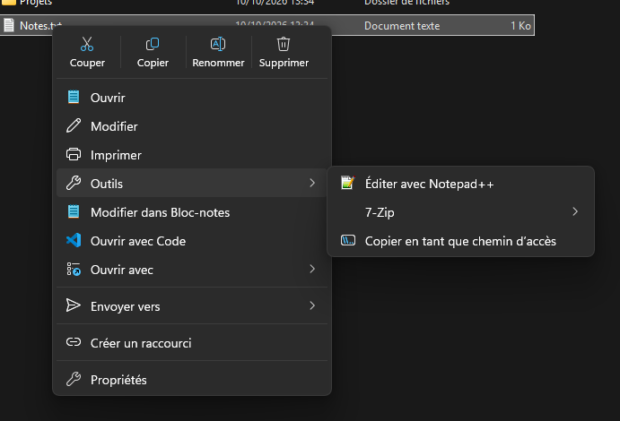
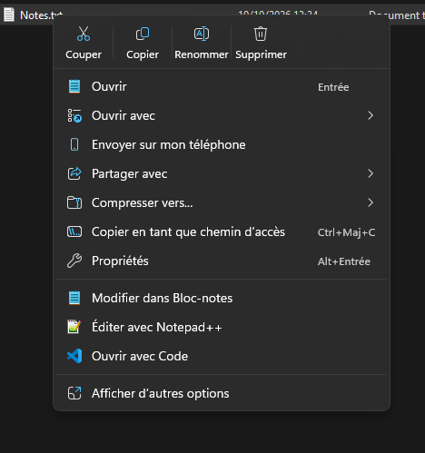

  

<h1 align="center">Windows 11 Contextual Menu</h1>

<strong>Reprenez la main sur le menu clic droit de Windows 11.</strong>

  
  
  
  

  

## Pourquoi ?

Le menu clic droit de Windows 11 a été simplifié, mais au prix de plusieurs irritants :

- **Deux menus au lieu d'un.** Beaucoup d'entrées (7-Zip, Notepad++, « Envoyer vers », « Imprimer »…) ne sont plus dans le nouveau menu : il faut cliquer sur « Afficher d'autres options » (ou Maj + F10) pour ouvrir l'ancien, à chaque fois.
- **Rien à régler.** Windows n'offre aucun moyen de retirer une entrée inutile (« Partager », « Caster sur l'appareil », les ajouts des logiciels installés…), d'en ajouter une à soi ou de changer leur ordre ; il faut passer par le registre.
- **Pas de retour simple à l'ancien menu.** Le rétablir par défaut demande une clé de registre peu connue, et l'ancien menu détonne : la plupart de ses entrées n'ont pas d'icône, et il ne ressemble pas au reste de Windows 11.
- **Un menu qui s'encombre** au fil des logiciels installés, sans possibilité de le ranger.

Windows 11 Contextual Menu règle tout cela, sans rien modifier de Windows lui-même : un interrupteur suffit pour retrouver le menu d'origine.

## Ce que ça fait

- **Choisir le menu du clic droit** : le menu moderne de Windows 11, l'ancien menu classique directement (sans passer par « Afficher d'autres options »), ou le **menu personnalisé**.
- **Masquer** les entrées de Windows et des applications (Partager, Épingler, Caster sur l'appareil, ESET, AMD…), dans le menu moderne comme dans le classique.
- **Ajouter vos entrées** : une commande simple ou un sous-menu (un modèle 7-Zip est fourni), dans les deux menus, sans redémarrage.
- **Le menu personnalisé** : le menu classique redessiné comme celui de Windows 11, en thème clair ou sombre, avec les mêmes icônes et la barre d'actions (Couper, Copier, Renommer, Supprimer). Toutes ses entrées se masquent, se rangent dans des groupes (avec une icône au choix), et se placent en haut ou en bas.
- **Un interrupteur** pour retrouver le menu d'origine à tout moment, sans perdre vos réglages.
- **Mises à jour** : l'application vous prévient d'une nouvelle version et l'installe en un clic.

Les deux autres menus au choix, pour le même fichier :

| Menu moderne | Menu classique |
| :---: | :---: |
|  |  |

  

## Installation

Windows 11 (25H2 ou plus récent), x64. Téléchargez la dernière version sur la page [**Releases**](https://github.com/Xavinooo/Windows11ContextualMenu.Releases/releases/latest).

**Quel fichier choisir ?**

- **Win11ContextMenu-Setup-selfcontained** (recommandé) : l'installeur complet. Tout est inclus (runtime .NET 10 et Windows App SDK). Il installe pour votre compte, sans droits administrateur, ajoute une entrée au menu Démarrer (et, si vous le voulez, une icône sur le Bureau). Se désinstalle depuis Paramètres > Applications.
- **Win11ContextMenu-Setup-light** : le même installeur, plus léger, mais il demande le [.NET 10 Desktop Runtime (x64)](https://dotnet.microsoft.com/download/dotnet/10.0) et le [Windows App SDK 2.5 Runtime (x64)](https://learn.microsoft.com/windows/apps/windows-app-sdk/downloads) ; il vérifie leur présence et propose leurs pages de téléchargement.
- **Win11ContextMenu-selfcontained** (zip) : la version complète, sans installation.
- **Win11ContextMenu-light** (zip) : la version light, sans installation (mêmes prérequis).

Pour un zip : décompressez le dossier où vous voulez le garder, puis lancez `ContextMenu.App.exe`. **L'application doit rester dans ce dossier** : c'est de là que Windows charge l'extension de menu. Si vous la déplacez, elle propose de refaire l'enregistrement.

**Avertissement de Windows.** L'application n'est pas signée par une autorité reconnue : au premier lancement de l'installeur ou de l'exe, Windows peut afficher « Windows a protégé votre PC ». Cliquez sur **Informations complémentaires**, puis **Exécuter quand même**.

**Certificat.** Au premier lancement, l'application installe un certificat auto-signé dans le magasin « Personnes autorisées » de l'ordinateur (une demande d'autorisation administrateur). Il sert uniquement à enregistrer son extension de menu auprès de Windows. « Désinstaller complètement » le retire.

## Premiers pas

1. Au premier lancement, cliquez sur **Installer** : l'application installe son certificat (une seule demande d'autorisation administrateur) et enregistre son extension de menu.
2. En haut de la fenêtre, choisissez le **menu par défaut** : Moderne, Classique ou Personnalisé.
3. Cochez « Masquer » sur les entrées dont vous ne voulez plus, puis cliquez sur **Redémarrer l'Explorateur** quand l'application vous le propose.
4. Dans **Mes entrées**, ajoutez vos propres commandes : elles apparaissent tout de suite, sans redémarrage.
5. En menu personnalisé, faites quelques clics droits (sur un fichier, un dossier, le fond d'un dossier) : la page **Entrées du menu** se remplit de ce que vous avez vu, et chaque entrée peut alors être masquée, groupée ou déplacée.

## Mises à jour

- Rien à configurer : au démarrage, au plus une fois par 24 h, l'application vérifie s'il existe une nouvelle version. La page **À propos** permet aussi de vérifier à la main et affiche l'historique des nouveautés.
- **Mettre à jour** télécharge la variante installée, vérifie son empreinte, remplace les fichiers et relance l'application. En cas d'échec, l'ancienne version est conservée.
- Le menu de l'Explorateur passe à la nouvelle version à l'ouverture d'une nouvelle fenêtre de l'Explorateur, ou à la prochaine session.
- Si l'application est installée dans un dossier protégé (comme `Program Files`), la mise à jour se fait à la main.

## Désinstallation

- **Dans l'application** : **Paramètres > Désinstaller complètement** rétablit le menu d'origine (entrées masquées rendues, extension de menu et certificat retirés), redémarre l'Explorateur et supprime vos réglages (tout le dossier `%LocalAppData%\Win11ContextMenu`). Pour une version zip, supprimez ensuite le dossier de l'application.
- **Version installée** : Paramètres > Applications > Windows 11 Contextual Menu > Désinstaller. Le désinstalleur rétablit le menu d'origine et vous demande s'il faut supprimer vos réglages et redémarrer l'Explorateur tout de suite (sinon, le menu d'origine revient à la prochaine session). Il ne retire pas le certificat : pour tout enlever, passez d'abord par « Désinstaller complètement ».

## Limites connues

- Quelques entrées du menu moderne ne peuvent pas être masquées (Copier en tant que chemin d'accès, Actions d'IA…) ; l'application les signale.
- Masquer « Compresser vers », « Envoyer sur mon téléphone » ou « Partager avec » fait retomber Windows sur l'ancien menu ; l'application vous en avertit.
- Masquer une entrée ou changer de menu par défaut demande de redémarrer l'Explorateur (un bouton le fait).
- Menu personnalisé : une entrée n'apparaît dans la page « Entrées du menu » qu'après avoir été vue une fois dans un vrai menu.
- Menu personnalisé : les lecteurs d'écran ne lisent pas les noms des entrées redessinées.

## Signaler un problème

Un bug, une idée ? Ouvrez une [Issue](https://github.com/Xavinooo/Windows11ContextualMenu.Releases/issues/new/choose). Une question, un avis ? Passez par les [Discussions](https://github.com/Xavinooo/Windows11ContextualMenu.Releases/discussions). Pour un bug, indiquez la version (page **À propos**) et joignez si possible le journal `%LocalAppData%\Win11ContextMenu\shell.log`. La page **À propos** de l'application a aussi un lien « Signaler un problème ».

## Licence

Gratuite, pour un usage personnel ou professionnel ; le code source n'est pas publié. Voir [LICENSE](LICENSE).
